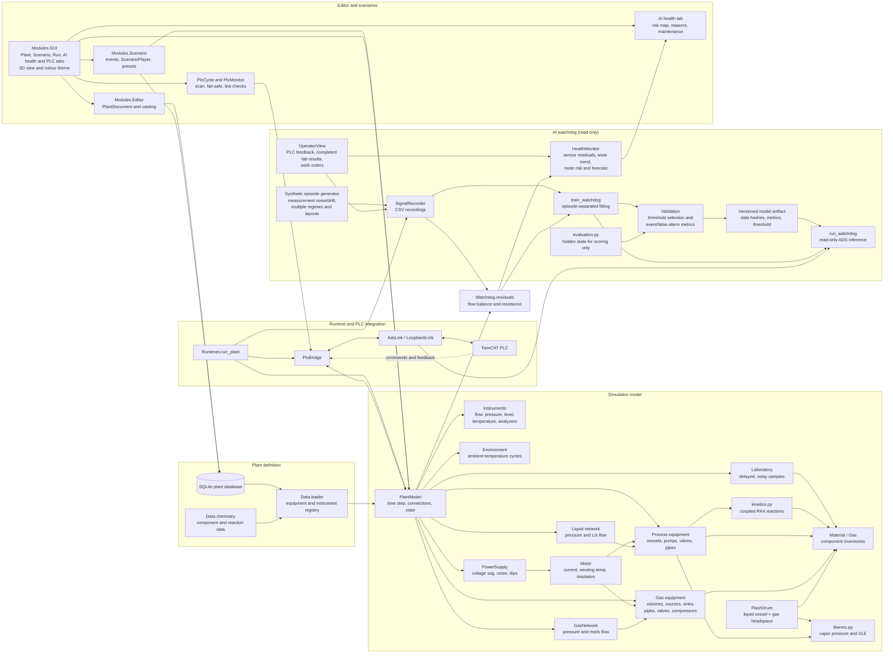

# plsim-chem architecture

The liquid and gas networks are separate solvers. A flash drum is a liquid vessel whose `gas*` / `vapor*`
ports also connect to the gas network.

## Layers

| Layer | Modules | Role |
|---|---|---|
| Definition | `Data/` | Database models, loader (`EQUIPMENT_TYPES`), chemistry defaults, tag table and GVL export |
| Physics | `Modules/Entity`, `Modules/Flow`, `Modules/Plant` | Equipment, material/gas inventories, thermo/kinetics, solvers, weather, power |
| PLC | `Modules/PLC` | `PlcBridge` (signals <-> PLC variables), `AdsLink`/`LoopbackLink`, `PlcCycle` and `PlcMonitor` |
| AI | `Modules/Watchdog` | Recorder, features, models, residuals, `HealthMonitor`, live `Watchdog` |
| Tools | `Modules/Editor`, `Modules/Scenario` | GUI-free editing API (`PlantDocument`) and scenario events |
| GUI | `Modules/GUI` | Tk tabs (Plant, Scenario, Run, AI health, PLC), `view3d`, `projection`, `theme` - thin, no logic |
| Entry points | `Runtimes/` | `run_plant`, `run_gui`, `train_watchdog`, `run_watchdog` |

Dependencies only point downwards: the GUI uses the tools and model, the model never imports the GUI.

**AI data boundary.** `OperatorView` (`Modules/Watchdog/access.py`) exposes PLC feedback, PLC commands (available
to the operator-facing monitor), completed lab results, plant time and the work-order log. Supervised models
train and infer on feedback channels; trip/fault channels are targets and excluded from model features. Lab
results are consumed by the GUI health monitor only once reported. The live ADS watchdog currently reads
feedback tags only. Hidden degradation state is available only from `Modules/Watchdog/evaluation.py` for
scoring and the optional GUI ground-truth display; no inference module imports it. `tests/test_ai_access.py`
audits signal leakage and scans inference sources for simulator internals. This is a code boundary, not a
security sandbox; deployment needs process isolation, least-privilege credentials, PLC read-only permissions,
and an independent security review.

Synthetic training (`Modules/Watchdog/scenarios.py`, fault time-shapes in `faults.py`, cached parallel generation in
`corpus.py`) draws randomised plants (loop, transfer, heated, reactor, tubular), 18 failure modes (cavitation variants, grid drift,
fouling, blockage, leak, wear, seized valve, heater runaway, reactor cooling loss / coolant fouling / warm coolant,
cold-wall product scaling (`wall_scaling`, generator v5), compounds, plus fault-free benign-transient,
sensor-nuisance and baseline days), random fault shapes (ramp, accelerating, step, saw-tooth, bursts), and
imperfect instruments (noise, drift, lag, offset, spikes, freezes, valve stiction). All of that is simulation
side; the model sees only `OperatorView` channels, and the evaluation-only `TRUTH.*` column is never a feature.
Random scheduled grid dips are excluded from predictive
labels because an unannounced event has no observable pre-event precursor. Validation selects a threshold under
a configured false-alarm budget; independent test episodes report AUC, event recall, alert precision, false
alarms per operating hour, and median lead time. The saved artifact includes model/schema version, source
fingerprints, train/validation/test provenance, metrics and the operating threshold. A no-alert threshold is
recorded explicitly if the validation set cannot meet the false-alarm budget with an alerting model.

Two detectors come out of training. The supervised `RiskModel` predicts a trip within the horizon. The normal-only
`SubspaceDetector` (`model.py`, saved beside the model as `*.anomaly.npz`) is fitted on fault-free episodes only
(PCA residual plus Hotelling T-squared of the window features, each scaled to its healthy 99th percentile, so 1.0
is the edge of normal). It has its own validation-selected threshold and, live, raises an advisory flag
(`Report.anomaly_alarm`) for behaviour unlike anything healthy, including failures nobody has recorded. Plants
differ in their sensors, so training uses the union of channels; a channel absent from a plant (reactor
temperature on a plain loop) reads 0.0 and is listed in the model's `optional_channels`, which the live watchdog
tolerates. `run_campaign` (`scenarios.py`) is a long "training plant": one plant that meets random incidents at
random times under a day/night and seasonal ambient cycle, is repaired and restarted by a simulated operator, and
feeds training (`--campaigns N`) and evaluation like any episode.

## One simulation step

1. `PlcCycle`/`PlcBridge` reads PLC commands (pump run, valve position ...) into equipment; on a lost link the
   fail-safe commands are applied instead.
2. `PlantModel.step`: power supply and motors, then the liquid network is solved (pressures, flows including static
   head `rho*g*dz` from each node's 3D location), then `_move_material` transfers moles (and slurry) along edges,
   then each vessel's `run_step` calls its subclass `update` (kinetics, VLE flash, evaporation, drying, column stages,
   slurry dissolution/settling). The gas network is solved the same way.
3. A slow loop (scaled by `slow_time_scale`) handles weather, fouling, freeze-thaw fatigue, wear and ageing.
4. Instruments are sampled and feedback is written to the PLC; `PlcMonitor` flags unmapped, frozen or ignored
   signals; the recorder and health monitor consume operator-visible feedback (read-only). The health monitor
   also receives lab results after their simulated turnaround time.

## Equipment model

- `ProcessEquipment` is the base class: `FAULTS`, `signals()`, state get/set and `repair()`.
- `Vessel` subclasses (`StorageTank`, `CSTR`, `FlashDrum`, `HeatExchanger`, `Evaporator`, `Dryer`,
  `DistillationColumn`) carry `Material`, plus `solids`, `slurry` (undissolved solids that need `mix_rate` and time
  to dissolve) and `frozen` state. Hooks: `condition_liquid`, `draw_at`, `receive_at`, `max_*_at` let a unit pick
  which port/stage material leaves or enters.
- `Pipe` carries slurry with the flow; undissolved solids grow `fouling` (blockage) and above `HOTSPOT_ONSET`
  add `fatigue` (pressure hotspots).

## Adding new equipment

1. Write the class (subclass `ProcessEquipment`, `Vessel` or `Transfer`) with `FAULTS`, `signals`, state, `repair`.
2. Register it in `Data/loader.py` `EQUIPMENT_TYPES`.
3. Add a catalog entry in `Modules/Editor/catalog.py` (ports, parameters, defaults).
4. Optionally add a 3D shape in `view3d.py` and a colour in `theme.py`.
5. Add tests under `tests/`.

## Known limits

Quasi-steady incompressible hydraulics (no water hammer); ideal mixing; Raoult's law by default (NRTL optional via
`thermo.set_activity_model`); simplified gas network; the column uses equilibrium stages with constant Murphree
efficiency, constant molar overflow, a reboiler and a total condenser only (no feed enthalpy, instant liquid
travel); pipe length is not derived from 3D geometry. Not built: PFR, filter, crystallizer, absorber. The thermo
functions are independent of the solver so they can be reused for more rigorous separation units.
Python runs a 23-unit plant at about 0.4 ms per step, so native code is only worth considering for large plants or
rigorous column solving.
