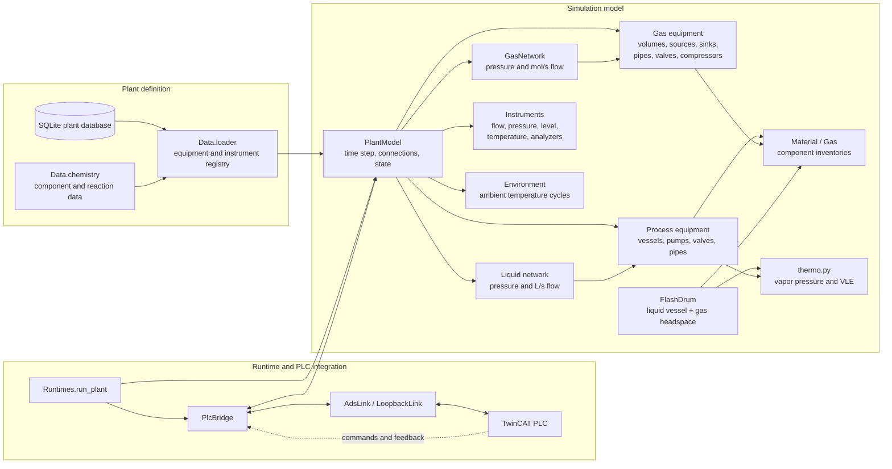

# plsim-chem architecture

The liquid and gas networks are separate solvers. A flash drum is a liquid vessel whose `gas*` / `vapor*`
ports also connect to the gas network.

`PlantModel` advances equipment and instruments each simulation step. `PlcBridge` maps the equipment's
signals to PLC tags; the database loader constructs the model from stored equipment, ports and connections.
Thermodynamic property functions are independent of the plant solver, which leaves room to reuse them in
future separation equipment such as distillation stages.
